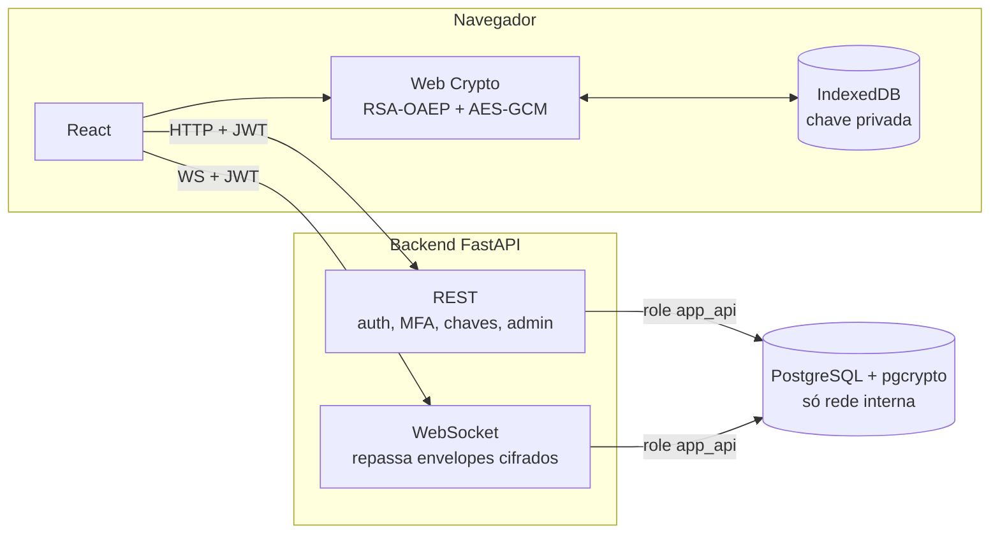

# E2EE Chat

Chat com criptografia ponta a ponta: as mensagens são cifradas e decifradas no navegador
(Web Crypto API) e o servidor só repassa envelopes que não consegue ler. Trabalho de Segurança.

```
backend/    FastAPI (API REST, WebSocket, JWT, MFA, auditoria)
frontend/   React + Vite + TypeScript (criptografia no cliente)
db/         PostgreSQL 16, pg_hba.conf e scripts de inicialização
docs/       documentação detalhada
```

## Arquitetura



- A chave privada nasce no navegador e nunca sai dele; o servidor guarda só a pública.
- Cada mensagem usa uma chave AES-256-GCM nova, cifrada com a RSA do destinatário.
- Senhas (bcrypt) e segredo TOTP (`pgp_sym_encrypt`) são tratados pelo pgcrypto no banco.

Fluxo completo, papel de cada camada e mapa do código em [docs/arquitetura.md](docs/arquitetura.md).

## Subindo do zero

**Pré-requisitos:** Docker com Compose v2 e Git. Nada mais precisa estar instalado no host.

### 1. Clonar e criar o `.env`

```bash
git clone https://github.com/Paludett/Trabalho-seguranca.git
cd Trabalho-seguranca
cp .env.example .env
```

### 2. Trocar senhas e segredos

Gere um valor novo para cada item abaixo:

```bash
python3 -c "import secrets; print(secrets.token_urlsafe(32))"
```

| Variável | Observação |
|----------|------------|
| `POSTGRES_PASSWORD` | superusuário de bootstrap |
| `DB_ADMIN_PASSWORD` | **repita** a mesma senha dentro de `MIGRATION_DATABASE_URL` |
| `APP_API_PASSWORD` | **repita** a mesma senha dentro de `DATABASE_URL` |
| `AUDITOR_PASSWORD` | |
| `JWT_SECRET` | |
| `TOTP_ENCRYPTION_KEY` | trocar depois invalida o MFA de todos |
| `ADMIN_PASSWORD` | mínimo 8 caracteres |

Use senhas diferentes entre si. O resto pode ficar com o valor do `.env.example`. Lista
completa em [docs/variaveis.md](docs/variaveis.md).

### 3. Subir

```bash
docker compose up --build
```

Na primeira vez o Postgres roda `db/init/`, que **habilita o `pgcrypto`** e cria as roles
`db_admin`, `app_api` e `auditor`. Em seguida o backend aplica as migrations
(`alembic upgrade head`) sozinho.

| Serviço | URL |
|---------|-----|
| Frontend | http://localhost:5173 |
| Backend | http://localhost:8000/health |
| Docs da API (só com `AMBIENTE=DEV`) | http://localhost:8000/docs |

O Postgres não tem porta no host; só o backend o alcança, pela rede interna do compose.

### 4. Criar o admin inicial (seed)

`/auth/register` sempre cria usuário comum. O primeiro admin vem do seed, que lê
`ADMIN_USERNAME` e `ADMIN_PASSWORD` do `.env`. Com o compose rodando, em outro terminal:

```bash
docker compose exec backend python -m app.seed
# admin 'admin' criado
```

Rodar de novo não muda nada. Outros admins são promovidos pela tela Admin.

### 5. Usar

1. Abra http://localhost:5173 e crie duas contas (uma em janela anônima ou outro navegador,
   já que cada navegador guarda a própria chave privada).
2. (Opcional) Configure o MFA com um app autenticador (Google Authenticator, Authy…) e
   guarde os backup codes; o próximo login pede o código TOTP.
3. Abra a conversa entre as duas, compare o fingerprint da chave e troque mensagens.
4. Entre com o admin para ver a tela de administração.

### Conferir

```bash
docker compose exec -e PGPASSWORD="$POSTGRES_PASSWORD" db \
    psql -U app -d e2ee_chat -c "\dx pgcrypto"     # extensão habilitada
./db/check_network.sh                              # banco só na rede interna
```

O `PGPASSWORD` precisa estar no seu shell (`set -a; source .env; set +a`).

## Problemas comuns

| Sintoma | Causa / solução |
|---------|-----------------|
| Backend falha com `password authentication failed` | Senha da role diferente da que está na URL, ou `.env` mudou depois de criar o volume. Confira o passo 2 e rode `docker compose down -v` (apaga os dados) |
| `function crypt(...) does not exist` / `gen_salt` | `pgcrypto` não habilitado: volume antigo ou banco criado por fora. Ver [docs/banco.md](docs/banco.md#pgcrypto) |
| Mudanças em `db/init/` ou `db/pg_hba.conf` não aparecem | `db/init/` só roda em volume novo: `docker compose down -v && docker compose up --build` |
| Seed: `senha fraca, minimo de 8 caracteres` | Aumente `ADMIN_PASSWORD` e rode o seed de novo |
| Seed: `KeyError: 'ADMIN_USERNAME'` | Variável faltando no `.env`; reinicie o backend depois de adicionar |
| Dependência nova no frontend não carrega | `docker compose down && docker compose up --build` (o `node_modules` fica em volume anônimo) |
| Recarregar a página desloga | Esperado: o token fica só em memória ([docs/seguranca.md](docs/seguranca.md#sessão-no-frontend)) |

## Testes

```bash
docker compose up -d --wait db
docker compose run --rm --no-deps backend pytest tests
```

Suíte de ataques, frontend e CI em [docs/testes.md](docs/testes.md).

## Documentação

| Arquivo | Conteúdo |
|---------|----------|
| [arquitetura.md](docs/arquitetura.md) | componentes, criptografia no cliente, fluxo de mensagem, mapa do código |
| [variaveis.md](docs/variaveis.md) | todas as variáveis de ambiente |
| [banco.md](docs/banco.md) | pgcrypto, roles, migrations, rede interna, seed |
| [seguranca.md](docs/seguranca.md) | limites contra DoS, rate limit, sessão, senhas e TOTP |
| [logs.md](docs/logs.md) | log JSON de auditoria e triggers do banco |
| [testes.md](docs/testes.md) | pytest, suíte de ataques, vitest e CI |
| [deploy-railway.md](docs/deploy-railway.md) | deploy em produção no Railway |
| [contrato.md](docs/contrato.md) | contrato backend ↔ frontend (erros, JWT, envelope, endpoints, WebSocket) |
