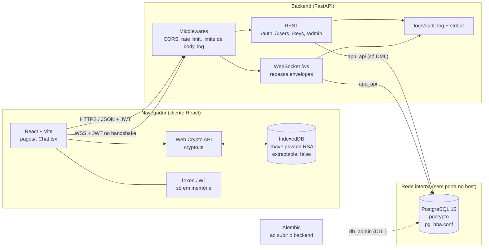
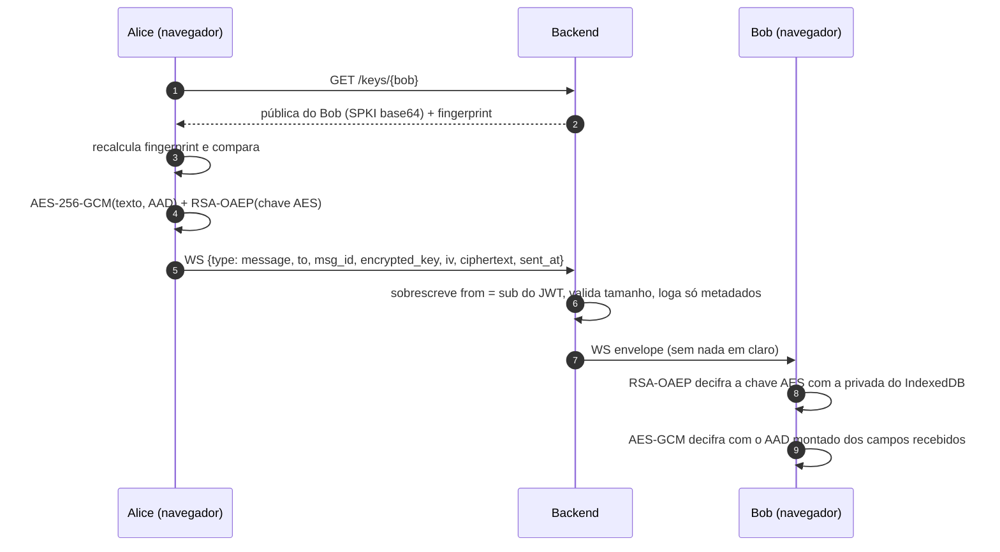

# Arquitetura

Três serviços, cada um com seu Dockerfile (`frontend/`, `backend/`, `db/`). No compose e no
Railway são os mesmos containers.



## Quem faz o quê

| Camada | Responsabilidade | Nunca vê/faz |
|--------|------------------|--------------|
| Cliente React | Gera o par RSA, cifra e decifra mensagens, verifica fingerprint, guarda o token em memória | Não envia chave privada nem texto claro |
| Backend | Autenticação (senha + TOTP), JWT, RBAC, guarda chave pública, roteia envelopes cifrados, rate limit, auditoria | Não tem como decifrar mensagem; não loga senha, token nem ciphertext |
| Banco | Usuários, chaves públicas, backup codes, `audit_log`, tokens revogados; hash de senha e cifra do TOTP via pgcrypto | Não guarda mensagens (o servidor só repassa); não é acessível de fora da rede interna |

## Criptografia no cliente

Detalhes do formato em [contrato.md §3](contrato.md#3-chaves-e-criptografia-no-cliente-web-crypto-api).

- **Par de chaves:** RSA-OAEP 2048, SHA-256, gerado no navegador no primeiro login
  (`frontend/src/crypto.ts`). A privada é `extractable: false` e fica no IndexedDB, por
  usuário. A pública vai para o servidor como SPKI em base64 (`PUT /keys/me`).
- **Fingerprint:** `hex(SHA-256(SPKI))`. O cliente recalcula a partir da chave recebida (não
  confia no valor do servidor) e mostra agrupado de 4 em 4 para conferência fora de banda.
- **Mensagem (envelope híbrido):** chave AES-256-GCM e IV de 12 bytes novos por mensagem; a
  chave AES vai cifrada com a RSA pública do destinatário.
- **AAD:** `msg_id|from|to|sent_at` amarra os metadados ao ciphertext. Se o servidor trocar
  remetente, destinatário ou id, a decifragem falha e a mensagem aparece como inválida.

Limitações conhecidas: outro navegador = outra chave (mensagens antigas não aparecem lá) e não
há assinatura do remetente, então a autenticidade do `from` depende do servidor.

## Fluxo de uma mensagem



## Login

Duas etapas: senha → token parcial de MFA (`scope=mfa_pending`, 5 min) → TOTP ou backup code → token de
acesso de 15 min. Detalhes em [contrato.md §5](contrato.md#5-login-em-duas-etapas).
Sessão no frontend em [seguranca.md](seguranca.md#sessão-no-frontend).

## Código

```
backend/app/
  main.py        app, middlewares (body, log de requisição), CORS
  routes/        auth, users, keys, admin
  ws.py          WebSocket e roteamento de envelopes
  security.py    pgcrypto (senha, TOTP, backup codes)
  tokens.py      JWT e revogação
  deps.py        auth, RBAC, paginação
  ratelimit.py   slowapi e bloqueio de login
  audit.py       audit_log + logger.py (arquivo JSON)
  seed.py        admin inicial
backend/alembic/ migrations (schema, grants, triggers)

frontend/src/
  crypto.ts      Web Crypto (RSA, AES-GCM, fingerprint, IndexedDB)
  auth.tsx       sessão (token em memória)
  api.ts         cliente REST
  socket.ts      cliente WebSocket
  Chat.tsx       cifra/decifra e monta o AAD
  pages/         Login, Register, MfaSetup, Home, Admin

db/
  init/          pgcrypto + roles (só no primeiro volume)
  pg_hba.conf    quem conecta e como
```
